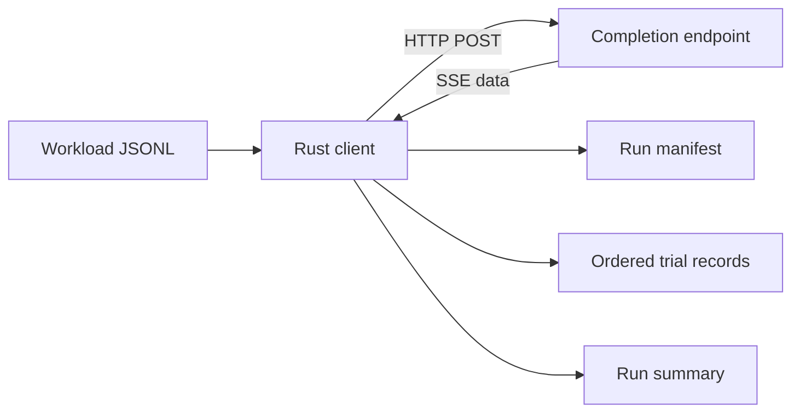

# Inference engine teardown

[](https://github.com/asigdel29/inference-engine-teardown/actions/workflows/check.yml)
[](LICENSE)

Replay one prompt trace against a streaming completions endpoint. The standalone Rust executable uses Tokio and streams responses over HTTP or HTTPS.

## Contents

[Quick start](#quick-start) · [Run an engine](#run-an-engine) · [Architecture](#architecture) · [Configuration](#configuration) · [Tests and benchmarks](#continuous-integration-and-benchmarks) · [Documentation](#documentation) · [Graphify](#graphify-source-map)

## Quick start

Install the standalone client with `cargo install --locked --path .`. For the Python module entry point, install the wheel with `python -m pip install .`. Source builds require a Rust toolchain.

Run `make check`. Run `make demo` to exercise three requests against a loopback fixture. The test also verifies a connection failure during each stream.

## Run an engine

Start a compatible engine with streaming completions and usage reporting enabled. Copy `fixture-config.json` and replace all five fixture values with the actual run configuration.

```sh
inference-engine-teardown --engine vllm --model MODEL --config config.json \
  --endpoint http://localhost:8000/v1/completions --out runs/vllm-001
```

Run the same command with a fresh output directory for each engine. Use the same workload, model revision, tokenizer, hardware, and precision. Set `--concurrency` to control simultaneous requests. The default is one.

## Architecture



| Component | Responsibility |
| --- | --- |
| Rust client | Validate input, bound active requests, and write results. |
| Completion endpoint | Serve the specified model and stream text, finish reasons, and usage. |
| Loopback fixture | Supply deterministic responses for tests and transport measurements. |

Each trial records the prompt, output, first visible text latency, total latency, and server-reported token count. A missing usage field produces a null count. One stream event can contain multiple tokens. The receiver measures time to first visible text. The timeout applies to socket operations.

A failed trial retains partial output and returns a failure status for the run. Select a new directory for each run to preserve earlier results.

## Measurement status

This release provides the transport harness and synthetic fixtures. Hardware measurements for vLLM, SGLang, and TensorRT-LLM require separate runs. The included workload is a smoke test.

## Continuous integration and benchmarks

CI tests Python 3.10, 3.12, and 3.14. Each job builds a wheel and checks its installed entry point and default workload.

Follow the [fixture procedure](docs/runbook.md) to measure loopback transport overhead. CI uploads its manifest, trial records, and summary. The fixture sends 60 requests with four concurrent clients and synthetic usage counts.

Use `--repetitions 20` for repeated engine trials. The summary reports nearest-rank p50, p95, and p99 latencies for successful requests. Throughput includes elapsed time for failures. Output-token throughput requires usage counts for every successful request.

## Configuration

| Input | Required values |
| --- | --- |
| CLI | Engine label, served model name, exact completions URL, configuration path, and a new output directory. |
| Configuration JSON | Nonempty strings for `engine_revision`, `model_revision`, `tokenizer_revision`, `hardware`, and `precision`. |
| Optional workload | One object per line with a unique string `id`, a string `prompt`, and a positive integer `max_tokens`. |

The embedded workload contains three prompts. The client defaults to one active request, one repetition, and a 120-second connection and read timeout.

## Project structure

| Path | Purpose |
| --- | --- |
| [src/](src/) | Rust CLI and streaming parser. |
| [inference_teardown/](inference_teardown/) | Python module entry point and the embedded trace. |
| [tests/](tests/) | Python reference client for differential tests. |
| [test_bench.py](test_bench.py) | End-to-end tests against the HTTP fixture. |

## Documentation

- [System design and UML diagrams](docs/system-design.md)
- [Wire protocol and failure handling](docs/design/protocol.md)
- [Result files and metric definitions](docs/design/results.md)
- [Runbook and troubleshooting](docs/runbook.md)
- [Measured test results](docs/test-log.md)
- [Repository instructions](AGENTS.md)

## Graphify source map

Read the [source map report](graphify-out/GRAPH_REPORT.md) or query the [graph data](graphify-out/graph.json). Open the [interactive map](graphify-out/graph.html) locally in a browser.

Install Graphify 0.9.76 with `uv tool install graphifyy==0.9.76`. Run these commands from the repository root.

```sh
make graph
graphify query "run_trial"
```

The build reads tracked Rust and Python files from the working tree, including tests. Stage new source files before you refresh the map. Graphify uses local syntax analysis with model backends disabled. The system design diagrams describe runtime behavior.

## Contributions

Run `make check` before you open a pull request. Include the trace and a fixture result when a change affects the wire protocol or metric definitions.

## Data handling

Run directories contain complete prompts and responses. Review the endpoint and configuration fields before sharing an artifact.

## License

Original code uses the [Apache License 2.0](LICENSE). The original workload prompts use [CC0 1.0](https://creativecommons.org/publicdomain/zero/1.0/).
