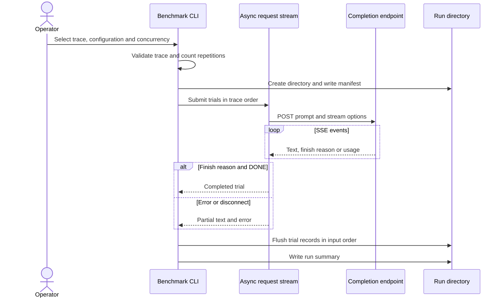
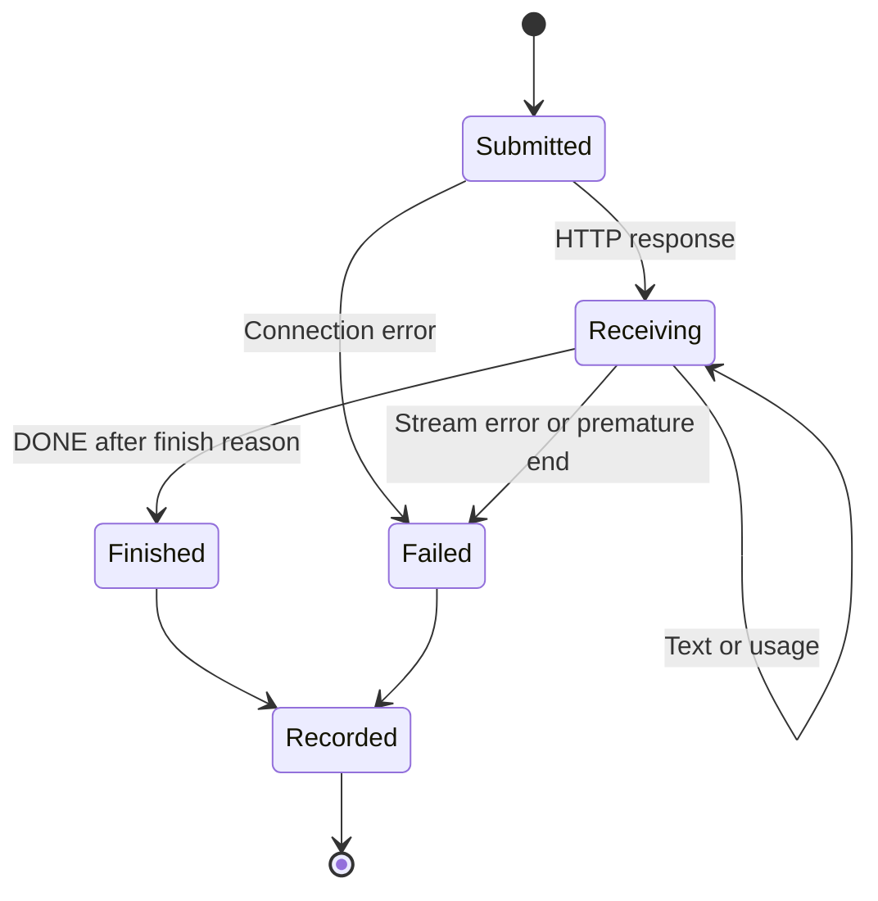

# Streaming benchmark system design

The client measures one completions endpoint per run. A Tokio future owns each active request. Requests share one HTTP connection pool. A single writer owns the output directory.

## Request lifecycle

## Trial state

## Interfaces and ownership

| Boundary | Contract |
|---|---|
| Workload → client | Each nonblank JSONL line supplies a unique string ID, a prompt, and a positive integer token limit. |
| Client → engine | Each POST uses a single prompt, temperature zero, streaming output, and a request for usage. |
| Engine → client | The parser joins consecutive SSE data fields and processes each blank-line-delimited event. The terminal event is `[DONE]`. |
| Client → archive | The manifest records the workload digest and run configuration. Each trial preserves text, timing, and completion status. |

The client limits active requests. A sequence number identifies each request. A map holds completed results until the writer can flush them in input order. A slow early request can delay output while later requests continue. Request timers start when the runtime polls each request.

## Measurement boundaries

First-text latency ends at the first nonempty text chunk. A chunk can contain several tokens. Total latency includes request construction, network time, and stream processing.

The summary uses nearest-rank percentiles over successful trials. First-text percentiles also require a visible chunk. Throughput divides successful request count by wall time across all trials. The client reports output-token throughput only when every successful trial has a usage count.

The client stores one copy of the workload and generates repetitions by index. The CLI writes each received result before it computes the final summary. An interrupted process can leave a manifest and a partial trial file.
